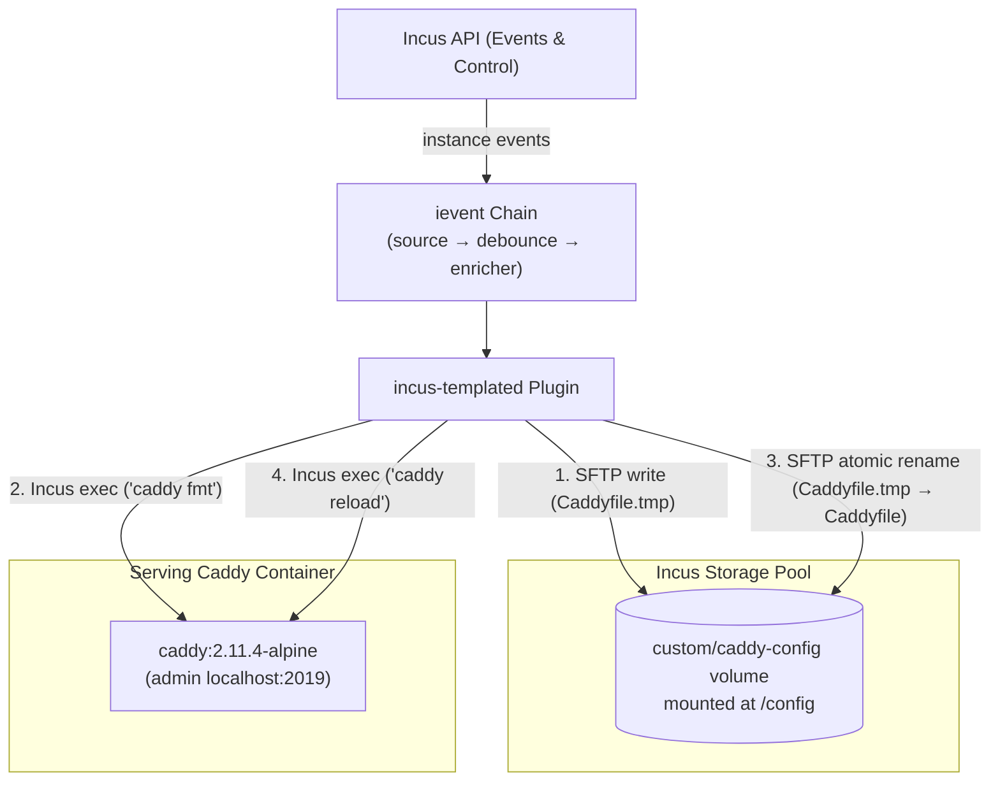

# incus-templated

Config files that follow your [Incus](https://linuxcontainers.org/incus/) instances: a Go template per target, re-rendered and deployed on every instance lifecycle event.

`incus-templated` watches your Incus fleet via the `ievent` stream, renders any Go template from instance labels in real time, checks the result with your own format and validate commands, and deploys it directly into persistent storage volumes via Incus SFTP or onto the local filesystem. The built-in Caddy preset does this for Caddyfiles, as shown below; [Prometheus `file_sd`](/examples/prometheus) needs only a template, and [Templates](/templates) covers anything else.



## Quick Example

With the Caddy preset, define Caddy and your backend application in `compose.yaml`:

```yaml
services:
  caddy:
    image: docker.io/library/caddy:2.11.4-alpine
    restart: unless-stopped
    ports:
      - "80:80"
      - "443:443"
    volumes:
      - config:/config
      - data:/data

  api:
    image: docker.io/library/busybox:latest
    command: httpd -f -p 8080
    labels:
      edge: "api.example.com,upstream=8080"

volumes:
  config:
  data:
```

When `incus-templated` runs with `--target edge,preset=caddy,instance=caddy,project=default`, it automatically discovers `api`, resolves its Incus bridge IPv4 address, and renders the reverse proxy block into Caddy:

```caddyfile
{
	admin localhost:2019
}

api.example.com {
	reverse_proxy 10.0.1.42:8080
}
```

When you scale, stop, start, or rename instances, Caddy reloads within milliseconds of the Incus event.

---

## Key Highlights

- **Zero Admin Port Exposure**: Caddy's Admin API is bound strictly to `localhost:2019` inside the container. No admin port is mapped to the host or public network.
- **Direct Storage Volume SFTP**: Files are written directly to the underlying Incus storage volume (`conn.GetStoragePoolVolumeFileSFTP`). If the consuming instance reboots or starts cold, it immediately boots with the current file.
- **Safe Atomic Swaps**: Renders in memory, writes a staging file, runs your optional format and validate commands inside the instance (`caddy fmt` and `caddy validate` for the preset), and atomically swaps it in via `sftp.PosixRename`. A file that fails validation never replaces the live one.
- **Single Goroutine Concurrency**: State reconciliation is strictly confined to a single goroutine (Rule A4). No mutexes, lock contention, or race hazards.
- **Warm Gating**: Changes are suppressed while the event chain is cold (`ChainCold`). Deployments only run once the fleet sweep completes (`ChainWarm`), eliminating route churn on startup.
- **Any Template**: Each target renders its own Go template with the labelled instances' names, labels, addresses, cluster member and devices; the Caddy preset adds per-vhost templates on top.

---

## Documentation Navigation

- [Getting Started](/getting-started) - Prerequisites, installation, and first deployment
- [Architecture & Security](/architecture) - Process isolation, volume resolution, and concurrency model
- [Configuration Reference](/configuration) - Targets, presets, the config file, CLI flags, environment variables, and HTTP endpoints
- [Caddy Labels & Routing](/labels) - The Caddy preset's labels, network resolution, and load balancing
- [Templates](/templates) - Template data and funcs, the Caddy preset, and per-vhost templates
- [Examples](/examples) - Complete stacks for Caddy and Prometheus
- [Deployment & Operations](/deployment) - Production compose stacks, reboot survival, and troubleshooting
